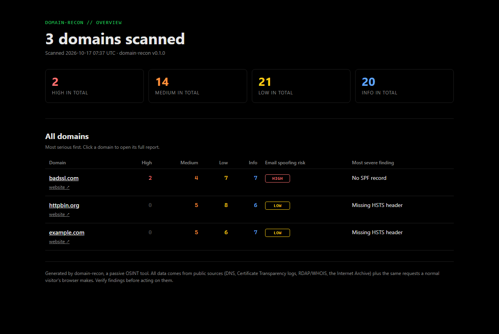
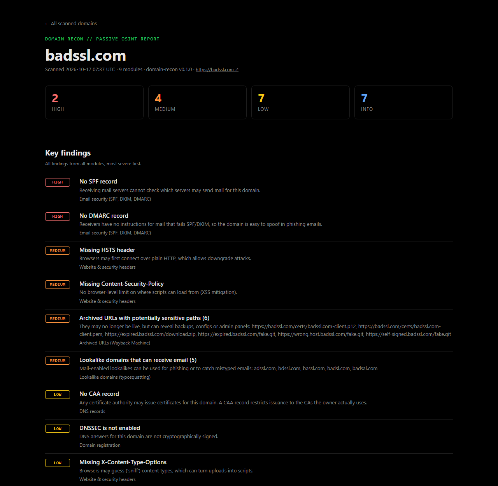

# domain-recon

[](https://github.com/skriptkiddy98x/domain-recon/actions/workflows/ci.yml)


**Passive OSINT reconnaissance for any domain, or a whole list of them.** Nine public data sources, one dark HTML report per domain, and an overview page that links them all.

Give it any domain and it answers the questions an analyst asks first: *What does this organisation expose? Can its email be spoofed? Which subdomains exist? Which lookalike domains could be used for phishing?* It answers them without scanning ports or attacking anything.

**[Live demo](https://skriptkiddy98x.github.io/domain-recon/examples/)**: an overview of three scanned domains. Click any domain to open its full report.



## Scan any domain, or many at once

```bash
domain-recon example.com                                         # one domain
domain-recon example.com example.org https://www.example.net/a   # several domains, URLs are fine
domain-recon -i domains.txt                                      # a list from a file
domain-recon -i domains.txt --open                               # ...and open the overview in a browser
domain-recon                                                     # no arguments: it asks which domains to scan
```

- Every domain gets its own report: `reports/<domain>.html` and `reports/<domain>.json`.
- When you scan more than one, you also get `reports/index.html`, an overview of **all scanned domains** with a link to each full report, plus `reports/summary.json`.
- The terminal prints a clickable `file:///` link to every report and to the overview.
- Input is cleaned up for you: `https://www.Example.com/page` becomes `example.com`, `shop.example.co.uk` becomes `example.co.uk` (it knows the [Public Suffix List](https://publicsuffix.org/)), internationalised names such as `žilina.sk` become punycode, duplicates are dropped and invalid entries are skipped with a note.

A domain file can be one domain per line, or domains separated by spaces or commas. `#` starts a comment:

```text
# domains to review
example.com
example.org, example.net
```

## What it checks

| Module | Question it answers | Data source |
|---|---|---|
| `dns` | Which DNS records exist? Which SaaS tools do TXT verification tokens reveal? | DNS |
| `registration` | Who is the registrar? How old is the domain, when does it expire, is it transfer-locked, is DNSSEC on? | RDAP, WHOIS fallback |
| `hosting` | Which IPs serve the site, who owns the network (ASN), is it behind a CDN? | Team Cymru IP-to-ASN, reverse DNS |
| `email` | Can someone send email pretending to be this domain? SPF, DMARC, DKIM, email providers | DNS |
| `tls` | Who issued the certificate, when does it expire, which *other* domains does it cover? | One TLS handshake |
| `http` | Missing security headers, version leaks, technology fingerprint, `robots.txt`, `security.txt` | Normal HTTP requests |
| `subdomains` | Which subdomains appear in Certificate Transparency logs? Which still resolve? Dangling CNAMEs (subdomain takeover)? Wildcard DNS? | crt.sh, CertSpotter |
| `wayback` | Did the Internet Archive capture backups, config files or admin panels? | Wayback Machine CDX API |
| `typosquat` | Which lookalike domains (`exmaple.com`, `example-login.com`, `examp1e.com`) exist, and which can receive email? | Generated permutations + DNS |

Every finding gets a severity (`high`, `medium`, `low` or `info`) and a one-line explanation of why it matters.



## Install

```bash
git clone https://github.com/skriptkiddy98x/domain-recon.git
cd domain-recon
python -m venv .venv
source .venv/bin/activate        # Windows: .venv\Scripts\activate
pip install -e .
domain-recon example.com
```

```
  domain-recon v0.1.0  |  3 domains  |  9 modules

  [1/3] badssl.com

  [+] DNS records                                 0.4s  1 finding
  [+] Email security (SPF, DKIM, DMARC)           0.4s  3 findings
  ...
  Report: file:///home/you/domain-recon/reports/badssl.com.html

  ========================================================================
  DOMAIN                              HIGH   MED   LOW  INFO   EMAIL SPOOFING
  badssl.com                             2     4     7     7   high
  httpbin.org                            0     5     8     5   low
  example.com                            0     5     6     7   low

  All domains: file:///home/you/domain-recon/reports/index.html
```

## Options

| Option | Default | Meaning |
|---|---|---|
| `domain ...` | | One or more domains or URLs |
| `-i, --input-file` | | Text file with domains to scan |
| `-m, --modules` | all | Comma-separated modules to run, e.g. `email,tls` |
| `-s, --skip` | none | Comma-separated modules to skip, e.g. `wayback,typosquat` for faster scans |
| `-o, --output-dir` | `reports` | Where to write the reports |
| `-f, --format` | `both` | `html`, `json` or `both` |
| `--open` | off | Open the report (or the overview) in your browser when done |
| `--timeout` | `15` | Network timeout in seconds |
| `--max-subdomains` | `200` | How many subdomains to resolve in DNS |
| `--max-lookalikes` | `300` | How many lookalike domains to check |
| `--list-modules` | | Show the available modules |

Press `Ctrl+C` during a long batch and the reports that were already finished are kept.

## Sample output

[`examples/`](examples) contains a real run against three domains that exist for testing and demos: [badssl.com](https://badssl.com), [example.com](https://example.com) and [httpbin.org](https://httpbin.org).

**[Open it live on GitHub Pages](https://skriptkiddy98x.github.io/domain-recon/examples/)** to click through the overview and the reports, or download the folder and open `examples/index.html` in a browser.

## How it works

```
targets.py ──> cli.py ──> scanner.py ──> modules/*.py (in parallel) ──> report.py ──> HTML + JSON
  (clean input)  (one domain at a time)                                   (per domain + overview)
```

- **Every module has the same shape:** `NAME`, `TITLE`, `SOURCE` and `run(ctx) -> ModuleResult`. Adding a check means adding one file and registering it in `modules/__init__.py`.
- **Collecting and judging are separate.** Network code fetches data; small pure functions such as `analyze_spf()`, `analyze_security_headers()` or `generate_lookalikes()` interpret it. That's why the analysis logic is unit tested without any network access.
- **One broken source never kills the scan.** crt.sh is often overloaded, so it's retried and then replaced by CertSpotter. If a module still fails, its section of the report explains why and the other modules carry on.
- **The JSON is the full truth.** The HTML pages are rendered from the same data and are self-contained files that are easy to share.

```
domain_recon/
├── cli.py            # command line, batch scanning, terminal output
├── targets.py        # turns domains, URLs and files into clean, unique domains
├── scanner.py        # runs the modules for one domain in parallel
├── report.py         # per-domain report, overview page, JSON
├── models.py         # Finding, ModuleResult, ScanContext, ScanReport
├── net.py            # shared HTTP session and DNS helpers
├── templates/        # report.html, overview.html, style.css (plain black theme)
└── modules/          # one file per check
```

## What "passive" means here

- No port scanning, brute forcing, exploit attempts or login attempts.
- Most data comes from third parties: DNS resolvers, Certificate Transparency logs, RDAP/WHOIS and the Internet Archive.
- Direct contact with the target is limited to what any visitor's browser does: one TLS handshake and a request for the homepage, `robots.txt` and `security.txt`.
- Requests carry an honest User-Agent (`domain-recon/<version>`).

## Legal and ethical use

Only run this against domains you own or have permission to assess. Even public data can be sensitive once it's combined. Findings are indicators, not proof: verify them before you act. A registered lookalike domain, for example, is often a defensive registration by the brand owner.

## Development

```bash
pip install -e ".[dev]"
pytest          # unit tests, no network needed
ruff check .    # lint
```

GitHub Actions runs lint and tests on Python 3.10 to 3.13 for every push.

## Roadmap

- [ ] Optional AI-written executive summary of the findings
- [ ] Shodan / Censys enrichment when an API key is provided
- [ ] `--compare` mode: diff two scans of the same domain and highlight what changed
- [ ] Markdown export for pasting into tickets

## License

[MIT](LICENSE)
